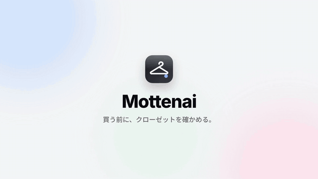

## まず、できあがったもの

服を買いに行くと、結局どれを買えばいいかわからず、**似た服や、手持ちと合わせづらい服を買ってしまう**。この悩みを解決するクローゼット管理アプリ **Mottenai**（「もったいない」と「持ってない」を掛けた名前）を作りました。

店で服を撮ると、クローゼットの中身すべてと比べて、数秒で答えが出ます。

- **買い／保留／見送り** の判定
- **＋N通り**：手持ちと組んで、コーデが何通り増えるか
- **似ている手持ち**：似ている度合い（%）つき

最初のプロンプトを入れてから、**スマホで実際にログインして使えるまで約2時間**でした。

- 最初の **約47分**：既存アプリの調査 → ペイン分析 → UX設計 → 実装 → テストまで（ここはほぼ Claude Code）
- 残りの **約1時間半**：GitHub への push と、Cloudflare・Google の設定（ここはほぼ私の手作業）
- TypeScript 約5,400行 ／ 設計ドキュメント 約1,500行 ／ ADR 4本 ／ テスト14件
- 運用費は **0円**（Cloudflare の無料枠だけで動かしています）

リポジトリは公開しています：[ttk1010/mottenai](https://github.com/ttk1010/mottenai)

ただ、この記事で伝えたいのは「速さ」ではありません。中心に据えたいのは、**最初に入れた1本のプロンプト**です。

## 元ネタ：usutakuさんのプロンプト

Instagram で AI 系の発信をしている usutaku さんが、タスク管理アプリを作るプロンプトを紹介していました。

```text
タスク管理アプリを作りたい
Webアプリ、モバイルファースト
開いた瞬間メモができることにこだわって
タスクはフリックでステータス管理したい
デザインは liquid Glass UIで白ベース
UI UXにアニメーションふんだんに用いて
全画面スケルトンローディングいれて
余計なキャッチコピーは一切不要
バックエンドは基本Cloudflareで
AI機能はWorkers AI用いて
ログイン機能は Google認証のみで
使う技術は任せるけど選定理由を全部教えて
GitHub レポジトリ作って公開まで
上記の指示は全部音声入力です
/goal 実際にブラウザ操作してテストに全合格して
```
*出典：usutaku さんの Instagram の投稿*

<!-- TODO: 投稿のリンクを出典に入れる -->

1行に1つの指示だけを置き、「何を作るか → こだわり → 見た目 → 技術 → 説明させること → ゴール」の順に並んでいます。このプロンプトを、**自分の悩みに置き換えて**使いました。

## 自分の悩みに置き換えた

実際に Claude Code に入れたプロンプトは、これだけです。

```text
クローゼット管理アプリを作りたい。
服を買いに行っても結局どんな服を買っていいかわからず、似通った服や手持ちと組み合わせづらい服を買いがち。この悩みを解決するためのアプリ。
Webアプリ、モバイルファースト。
服の登録の手軽さにこだわって。
コーデ提案、買うと良い服の提案も機能として必要。
デザインは liquid Glass UIで白ベース。
UI UXにアニメーションふんだんに用いて。
全画面スケルトンローディングいれて。
余計なキャッチコピーは一切不要。
バックエンドは基本Cloudflareで。
AI機能はWorkers AI用いて。
ログイン機能はGoogle認証のみで。
使う技術は任せるけど選定理由を全部教えて。
GitHub レポジトリ作って公開まで。
/goal まずは既存アプリの調査と、ペインの徹底的な分析に基づくUX設計まで完了させて。
```

元のプロンプトと並べると、変えたのは一部だけです。

| 要素 | 元のプロンプト | 私の版 |
| --- | --- | --- |
| 作るもの | タスク管理アプリ | クローゼット管理アプリ |
| 形態 | Webアプリ、モバイルファースト | **そのまま** |
| 悩み | （なし） | **似通った服や手持ちと組み合わせづらい服を買いがち**（追加） |
| こだわり | 開いた瞬間メモができること | 服の登録の手軽さ |
| 必須機能 | フリックでステータス管理 | コーデ提案、買うと良い服の提案 |
| 見た目 | Liquid Glass・白ベース・アニメーション・全画面スケルトン・キャッチコピー不要 | **そのまま** |
| 技術 | Cloudflare・Workers AI・Google 認証のみ | **そのまま** |
| 説明と公開 | 選定理由を全部教えて／GitHub で公開まで | **そのまま** |
| 入力方法 | 全部音声入力です | （削除） |
| ゴール（/goal） | 実際にブラウザ操作してテストに全合格して | まずは既存アプリの調査と、ペインの徹底的な分析に基づくUX設計まで |

**形態・見た目・技術・説明・公開の10行は、そのまま借りています。** 書き換えたのは「何を作るか」「こだわり」「機能」と、ゴールだけ。そこに、元のプロンプトにはない「悩み」の1行を足しました。

ゴールも変えています。元は「ブラウザで操作してテストに全部通るまで」と、完成まで一気に走らせる書き方です。私は、まず「既存アプリの調査とUX設計まで」で止めて、中身を確かめてから実装に進む形にしました（実装のあとには、ブラウザでの動作確認もしてもらっています）。

置き換えるときに意識したのは、**悩みをできるだけ具体的な「失敗」として書く**ことです。「おしゃれになりたい」ではなく「似通った服や、手持ちと組み合わせづらい服を買いがち」。こう書いたことで、アプリの主役が最初から決まりました。

## プロンプトを1行ずつ分解する：何が返ってきたか

プロンプトの各行が、成果物のどこに効いたかを並べるとこうなります。

| プロンプトの1行 | 返ってきたもの |
| --- | --- |
| 似通った服や手持ちと組み合わせづらい服を買いがち | 失敗を「何を買えばいいか分からない／似た服を買う／合わない服を買う」の3つに分けたペイン分析。主役は **店で決める瞬間**（買う前チェック） |
| 服の登録の手軽さにこだわって | 連続撮影、必須の入力は写真だけ、AI のタグの確認は後回し。買う前チェックの「買った」で、撮った写真のまま登録。目標は **1着3秒** |
| コーデ提案、買うと良い服の提案 | どちらも「**＋N通り**（組み合わせが何通り増えるか）」で評価。今日のコーデの3案のうち、1案は必ず出番のない服を使う |
| 余計なキャッチコピーは一切不要 | 「画面の文言はラベル・数字・操作だけ」というルールにして、`CLAUDE.md` に残した |
| 使う技術は任せるけど選定理由を全部教えて | 技術ごとに理由を書いた資料。作ってみて変えた点（使わなかった技術とその理由）まで追記された |
| /goal まずは…UX設計まで完了させて | 最初は調査・分析・設計の資料だけが返ってきた。**実装の前に、方向が合っているか確かめる区切り**になった |

特に効いたと感じたのは、最後の2行です。

- **「選定理由を全部教えて」**：AI に任せると、技術選定は「よくある構成」に寄りがちです。理由を書かせると、説明できない選択が残りません。
- **「/goal」で途中までに区切る**：いきなり実装させず、まず調査と設計だけを出させました。ここで中身を読んで「これでいい」と判断してから、実装に進めています。

## 調査とUX設計：先に「なぜ」を固めた

既存アプリ（Whering、Indyx、Acloset、XZ など）を調べると、共通点が見えてきました。

- **登録が最大の壁**：1着30〜60秒かかり、100着で2時間。ここで続かなくなる
- **コーデ提案は「家で何を着るか」に偏っている**：店で迷う瞬間を助けるアプリが見当たらない
- **買い物機能は売るための仕組み**：提携ブランドへの送客モデルなので、「買わない方がいい」とは言いにくい

ここから、設計の方針を決めています。

- **決める瞬間に答える**：家の朝ではなく、店頭で
- **形容詞より数字**：`似ている 87%`、`＋12通り`
- **売り込まない**：送客をしないので、「見送り」と言える

調査とペイン分析の資料は、リポジトリの `docs/` に全部残っています。

## 実装：判定はルール、AIはタグ付けだけ


*ほぼ同じ白Tを持っているので「見送り」*

AI 機能は Workers AI で、と指定しましたが、**AI に任せたのは「写真 → タグ」だけ**です。カテゴリ・柄・きちんと度・季節などを写真から読み取らせます。

「合う・合わない」の判定そのものは、決まった計算（ルール）で行います。

```
相性 ＝ 色 × きちんと度 × 柄 × シルエット   → 0.6以上なら「合う」
```

- **色**：写真の画素から主色を測り、白・黒・ネイビー・ベージュ・デニムなどは「何にでも合う色」として扱う
- **きちんと度**：1〜5の差が1つ開くごとに減点
- **柄**：柄物同士は大きく減点
- **シルエット**：上下ともゆったりなら少し減点

AI に判定まで任せない理由は、**画面に出す数字の根拠を説明できるようにするため**です。同じ服なら、いつも同じ判定と数字になります。

とはいえ、作ってみて弱点も見つかりました。たとえば「白T × 黒のスラックス」は実際にはよくある組み合わせですが、きちんと度の差を厳しく見すぎて「合わない」になります。こうした課題は、次の版で直す予定です。

## プロンプトに書いていなかったこと：人が決めた場面

プロンプト1本で全部が決まったわけではありません。途中で、人が判断した場面がいくつもありました。

- **名前**：AI に8案出してもらい、ネーミングの遊び心を参考にもじった案から「Mottenai」を選びました
- **無料で動かせるか**：作ってから「Cloudflare で無料で動かせる？」と聞き、無料枠に収まる構成と、枠を超えたときの動き（課金ではなく機能が止まる）を確かめました
- **アカウントまわりの設定**：Cloudflare の API トークン、データベース、Google ログインの設定は、私がダッシュボードで手を動かしました。トークンの有効期限を90日にする、といった判断も人間側です

冒頭の「残りの約1時間半」は、ほぼこの設定の時間です。

## ハマりどころと学び

- **AI が GitHub のリポジトリを作れなかった**：プロンプトに「GitHub レポジトリ作って公開まで」と書きましたが、作業環境の権限で、新しいリポジトリの作成はできませんでした。空のリポジトリだけ私が作り、push は AI に任せました。リリースタグの作成も同じ理由で、最後は私がブラウザで行っています
- **最初の公開が失敗した**：Cloudflare のアカウントに `workers.dev` のサブドメインがまだなく、自動公開が止まりました。ダッシュボードを一度開いて解決。こうした「初回だけの詰まり」は、手順書とトラブル対処の資料にまとめてもらいました
- **秘密の値の置き場所**：Google のシークレットを、私が Cloudflare ではなく GitHub に登録してしまいました。結果的に「GitHub に置いた値を、公開のたびに Cloudflare へ自動で反映する」形にしてもらい、置き場所が1か所になりました

学びを一言でいうと、**AI エージェントは調査・設計・実装は速いが、アカウント・権限・お金の判断は人に残る**、ということでした。

## まとめ：プロンプトに書いてよかったこと

今回のプロンプトを振り返ると、効いたのは次の5つでした。

1. **悩みを具体的な失敗として書く**：「似た服・合わない服を買いがち」が、主役の機能を決めた
2. **一番のこだわりを1つ書く**：「登録の手軽さ」が、カメラから始まる設計につながった
3. **やらないことを書く**：「余計なキャッチコピーは一切不要」が、画面のルールになった
4. **理由を説明させる**：「選定理由を全部教えて」で、説明できない選択が残らなかった
5. **ゴールを区切る**：「/goal まずは…UX設計まで」で、実装の前に方向を確かめられた

usutaku さんのプロンプトのうち、10行はそのまま借りました。**型はそのまま借りて、中身だけを自分の悩みに置き換える**。それだけで、AI が返してくるものの解像度がぐっと上がりました。

次は、相性の判定ロジックの調整（v0.2）について書く予定です。
